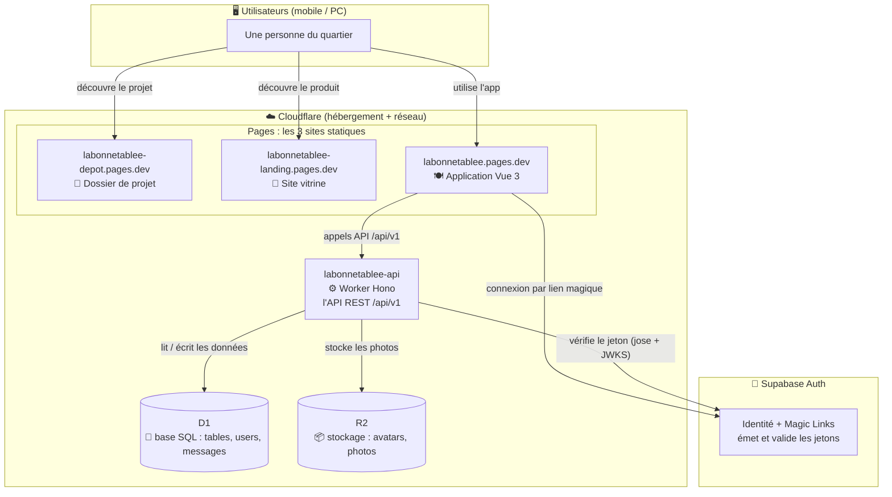
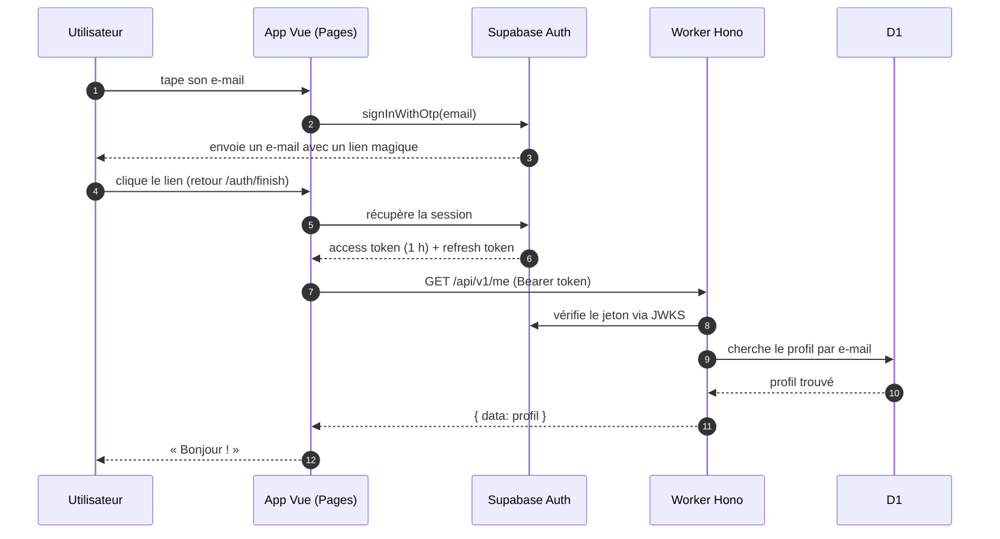
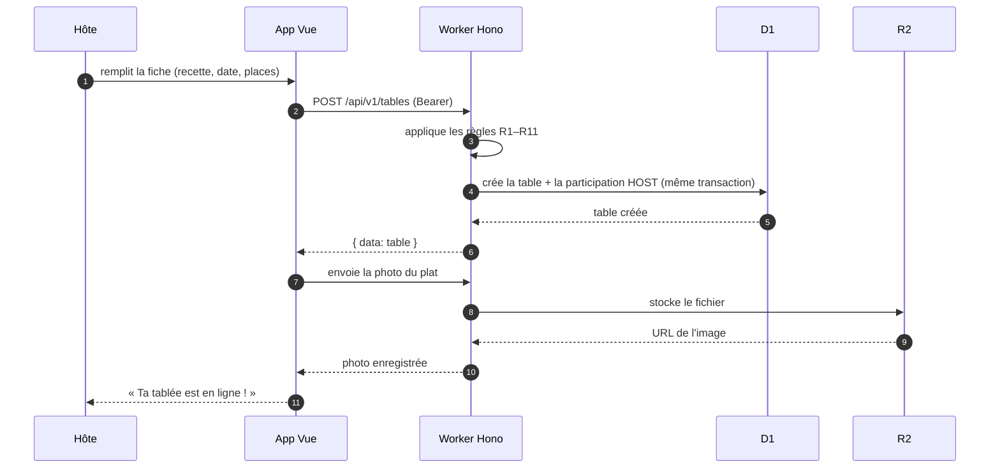

# Architecture & Stack — La Bonne Tablée

Présentation technique courte et visuelle. Objectif : expliquer simplement, sans
rien trahir de la technique, comment l'ensemble s'imbrique et fonctionne.

## L'idée en une image

On a **3 vitrines** qui partagent un seul **cerveau** (l'API) et un seul
**carnet de réservation** (la base de données) :

- le **site vitrine** = la devanture du restaurant (on découvre le concept)
- le **dossier de projet** = les coulisses (le rendu étudiant)
- **l'application** = la salle à manger (on réserve, on cuisine, on discute)

Tout est hébergé chez **Cloudflare**, et l'identité des utilisateurs est gérée par
**Supabase**.

## 1. Le schéma d'architecture global

À retenir : le front ne parle **jamais** directement à la base. Il passe toujours par
l'API, qui est la seule à connaître les règles du métier.

## 2. La stack technique

| Couche | Outils | Rôle en une phrase |
|---|---|---|
| Interface | Vue 3, Vite, Tailwind CSS, shadcn-vue | l'application (SPA installable / PWA) |
| État & navigation | Pinia, vue-router | mémoriser la session et naviguer |
| Authentification | Supabase Auth | « qui est qui », sans mot de passe |
| API | Hono sur Cloudflare Workers | toutes les règles métier, base `/api/v1` |
| IA | Cloudflare Workers AI | enrichir une description, proposer des plats |
| Base de données | Cloudflare D1 (SQL) | tables, utilisateurs, messages, participations |
| Fichiers | Cloudflare R2 (compatible S3) | avatars et photos |
| Hébergement | Cloudflare Pages | les 3 sites publics |

## 3. Comment on se connecte (le lien magique)

Le rafraîchissement est automatique : tant que Supabase accepte le refresh token,
l'utilisateur reste connecté sans repasser par un e-mail.

## 4. Comment on crée une tablée (le cœur du métier)

Les règles importantes (places calculées, hôte impossible à expulser, adresse masquée,
etc.) sont toutes appliquées **côté API**, jamais côté navigateur : c'est ce qui rend
l'application fiable.

## 5. Mini-lexique ludique

- **Cloudflare Pages** : le serveur qui « sert les plats » (les fichiers) aux visiteurs.
- **Cloudflare Workers** : le serveur qui « cuisine » (l'API), sans machine à gérer.
- **D1** : le carnet de réservation (base SQL) — tout est noté, rien n'est perdu.
- **R2** : le placard à photos (stockage de fichiers).
- **Supabase Auth** : le portier qui vérifie l'identité sans demander de mot de passe.
- **Magic link** : le ticket d'entrée envoyé par e-mail, valable 15 minutes.
