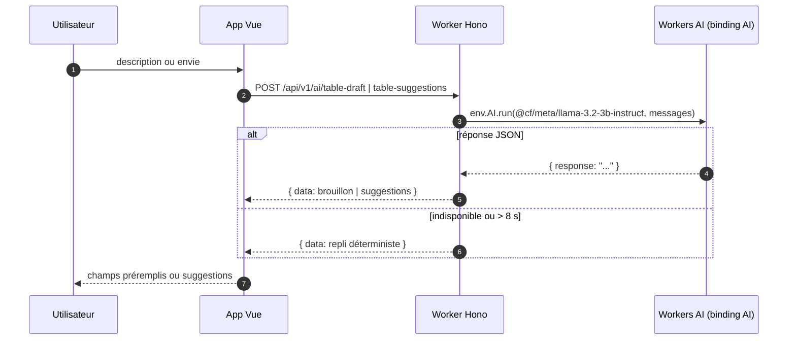

# ARCHITECTURE — La Bonne Tablee (prod)

La production a remplace Firebase par Supabase Auth et Cloudflare Pages.
Le POC historique reste documente dans `specs/IMPLEMENTATION-ARCHITECTURE.md`.

Schema :

- `landing/` : dossier de projet statique -> Cloudflare Pages projet `labonnetablee-depot`.
- `landing-vitrine/` : site vitrine statique -> Cloudflare Pages projet `labonnetablee-landing`.
- `public/` : app Vue 3 + shadcn-vue PWA (racine Vite, publicDir `static`, build `public/dist`).
  Le fichier `public/static/_redirects` assure le fallback SPA.
- `workers/` : API Hono, base unique `/api/v1`, D1 (metier) + R2 (avatars).
- Auth : code OTP à 6 chiffres / lien magique Supabase (SMTP Gmail). Le Worker verifie le jeton via `jose` + JWKS
  (`<SUPABASE_URL>/auth/v1/.well-known/jwks.json`). `POST /auth/magic-links` et
  `POST /auth/sessions` restent disponibles pour le parcours de test et les tests e2e.
- Donnees : D1 prod (`workers/migrations/0001_prod_init.sql`), conventions UML
  (UUID v4 serveur, Instant ISO8601 UTC, enums UPPER_SNAKE, Decimal jamais float,
  champs calcules jamais stockes). Titre `{dishName} chez {host.firstName}` derive.
- Regles R1-R12 + confidentialite R7/R8 codees cote Worker (voir `workers/src/`). R5 = `0..N` apports par participation (migration `0007`).
- Listes `{data, pagination}`, erreurs `{error:{code,message,details}}`, codes stables
  (voir `docs/API.md`). Pagination obligatoire sur /tables, /me/tables, messages.

## Intelligence artificielle — Workers AI

La démo combine Gemini (prioritaire, clé `GEMINI_API_KEY`) et Cloudflare Workers AI
(binding `[ai]` -> `AI`, modèle `@cf/meta/llama-3.2-3b-instruct`), avec repli local.

- `POST /api/v1/ai/table-draft` : description + `ambianceHint` optionnel ->
  `dishName`, `description` (plat uniquement), `ambiance` (paragraphe ≤ 300
  caractères, distinct du plat), `moteur`, `dishImageUrl` (ThemealDB),
  `wantedContributions`, `seatsTotal`, `durationMinutes`.
- `POST /api/v1/ai/table-suggestions` : jusqu'à 4 plats choisis UNIQUEMENT parmi
  les tablées `OPEN`/`FULL` existantes, repli lexical déterministe.
- Repli : si Gemini et Workers AI sont indisponibles ou si l'appel dépasse
  8 secondes, l'API renvoie un brouillon/suggestions déterministe sans planter.
- Explorateur : l'autocomplétion et le repli « populaires » sont 100 % base
  locale (plats des tablées à venir, sans ville ni quartier), sans appel IA.

Workers AI est actif par défaut sur le compte : il n'y a pas de bouton
d'activation. On vérifie avec `npx wrangler ai models`. Les appels sont facturés
en Neurons, avec une allocation quotidienne gratuite suffisante pour une démo.

