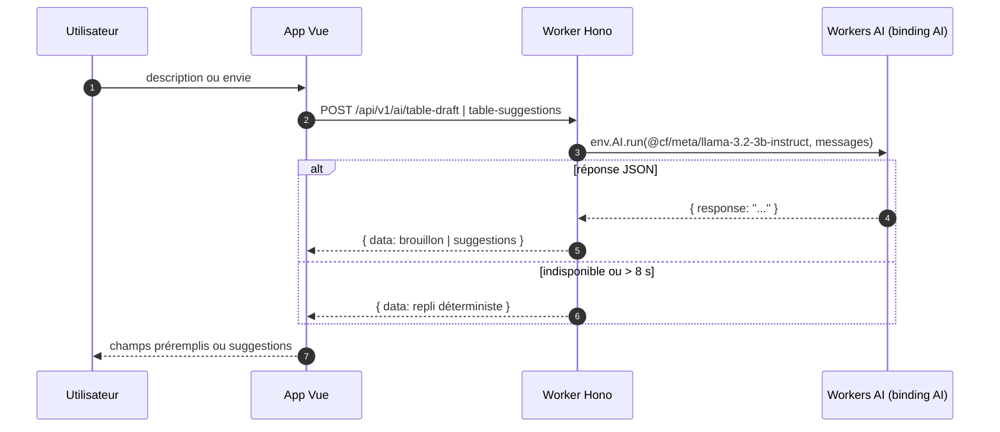

# ARCHITECTURE — La Bonne Tablee (prod)

La production a remplace Firebase par Supabase Auth et Cloudflare Pages.
Le POC historique reste documente dans `specs/IMPLEMENTATION-ARCHITECTURE.md`.

Schema :

- `landing/` : dossier de projet statique -> Cloudflare Pages projet `labonnetablee-depot`.
- `landing-vitrine/` : site vitrine statique -> Cloudflare Pages projet `labonnetablee-landing`.
- `public/` : app Vue 3 + shadcn-vue PWA (racine Vite, publicDir `static`, build `public/dist`).
  Le fichier `public/static/_redirects` assure le fallback SPA.
- `workers/` : API Hono, base unique `/api/v1`, D1 (metier) + R2 (avatars).
- Auth : lien magique Supabase. Le Worker verifie le jeton via `jose` + JWKS
  (`<SUPABASE_URL>/auth/v1/.well-known/jwks.json`). `POST /auth/magic-links` et
  `POST /auth/sessions` restent disponibles pour le parcours de test et les tests e2e.
- Donnees : D1 prod (`workers/migrations/0001_prod_init.sql`), conventions UML
  (UUID v4 serveur, Instant ISO8601 UTC, enums UPPER_SNAKE, Decimal jamais float,
  champs calcules jamais stockes). Titre `{dishName} chez {host.firstName}` derive.
- Regles R1-R11 + confidentialite R7/R8 codees cote Worker (voir `workers/src/`).
- Listes `{data, pagination}`, erreurs `{error:{code,message,details}}`, codes stables
  (voir `docs/API.md`). Pagination obligatoire sur /tables, /me/tables, messages.

## Intelligence artificielle — Workers AI

La démo intègre Cloudflare Workers AI, choisi parce qu'il reste dans la stack
Cloudflare (aucune clé externe, aucun CORS supplémentaire).

- Binding : `[ai]` -> `AI` dans `workers/wrangler.toml`.
- Modèle : `@cf/meta/llama-3.2-3b-instruct` (texte rapide et léger).
- Endpoints : `POST /api/v1/ai/table-draft` (enrichit une description en
  brouillon) et `POST /api/v1/ai/table-suggestions` (propose des plats selon
  une envie, une humeur ou une saison).
- Repli : si le binding est absent, si Workers AI n'est pas disponible ou si
  l'appel dépasse 8 secondes, l'API renvoie un brouillon/suggestions
  déterministe sans planter.

Workers AI est actif par défaut sur le compte : il n'y a pas de bouton
d'activation. On vérifie avec `npx wrangler ai models`. Les appels sont facturés
en Neurons, avec une allocation quotidienne gratuite suffisante pour une démo.

