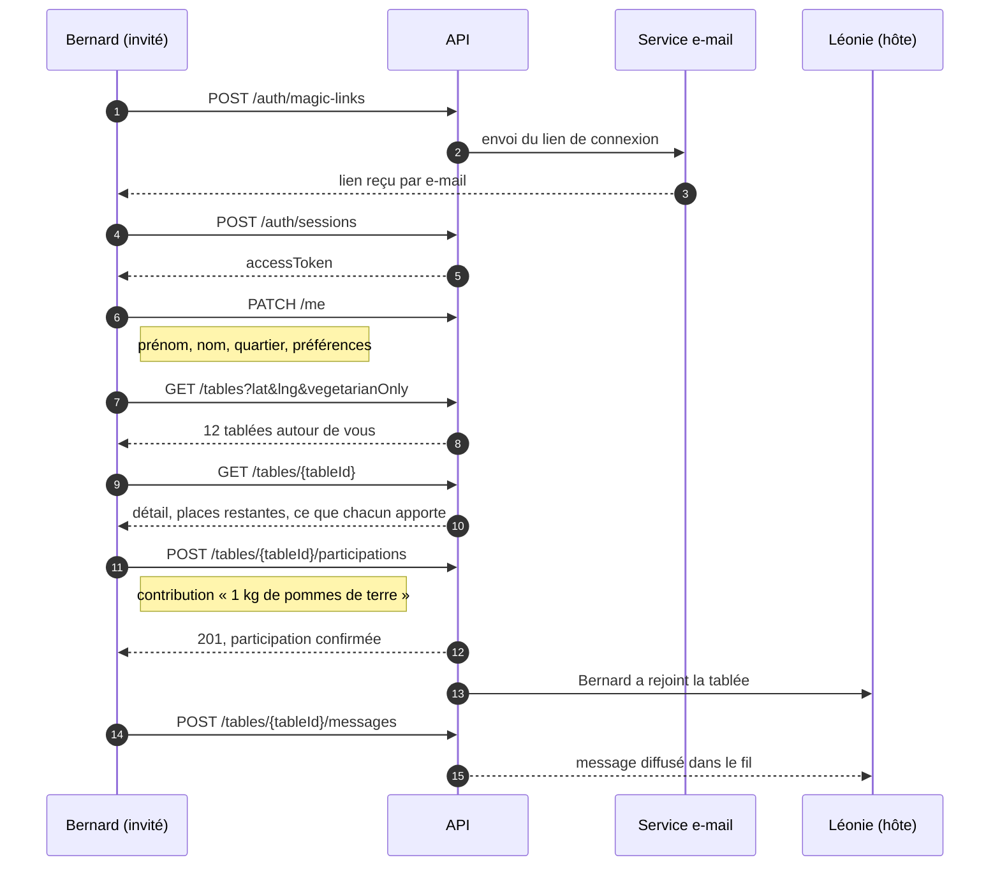

# La Bonne Tablée — spécifications du scénario minimal

Deux livrables, dérivés du parcours client de la maquette :

| Livrable | Fichier |
|---|---|
| Modèle de données UML | [uml/modele-donnees.md](uml/modele-donnees.md) et [uml/modele-donnees.mmd](uml/modele-donnees.mmd) |
| Spécification OpenAPI 3.1 | [openapi/openapi.yaml](openapi/openapi.yaml) |
| Requêtes de démonstration | [openapi/parcours.http](openapi/parcours.http) |

---

## 1. Le scénario minimal retenu

Le plus petit parcours qui a de la valeur de bout en bout : **Bernard découvre une tablée
près de chez lui, choisit ce qu'il apporte, la rejoint, puis échange avec le groupe.**

| # | Étape | Écran de la maquette | Appels API |
|---|---|---|---|
| 1 | Bernard demande un lien de connexion | Bon retour ! | `POST /auth/magic-links` |
| 2 | Il ouvre le lien et obtient un jeton | — | `POST /auth/sessions` |
| 3 | Il complète son profil | Onboarding « vous êtes ? », Prénom, Nom, adresse | `GET /me`, `PATCH /me` |
| 4 | Il voit ses tablées à venir | Accueil, « À venir » / « Passées » | `GET /me/tables` |
| 5 | Il cherche un repas près de lui | Explorer, filtres « Ce soir », « Végétarien » | `GET /tables` |
| 6 | Il ouvre une tablée | Détail « Gratin dauphinois chez Léonie » | `GET /tables/{tableId}` |
| 7 | Il choisit ce qu'il apporte et confirme | Votre contribution, « Que peux-tu apporter ? » | `POST /tables/{tableId}/participations` |
| 8 | Il échange avec le groupe | Messages, fil « Gratin chez Léonie » | `GET` et `POST /tables/{tableId}/messages` |

Deux appels complètent la boucle : `POST /tables` (l'écran « Créer une tablée », sans lui il
n'y a pas d'offre) et `DELETE /tables/{tableId}/participations/me` (se désinscrire, qui doit
toujours exister si l'inscription existe).

---

## 2. Hors périmètre minimal

Ces écrans de la maquette sont identifiés et volontairement écartés. Chacun est un ajout
additif au modèle, sans rupture des contrats existants.

| Écarté | Écrans concernés | Ce qu'il faudra ajouter |
|---|---|---|
| Avis et notes | « Léonie · 4,9 (18 avis) » | Entité `Review`, agrégat `rating` alimenté |
| Recettes | « Des idées de recettes », « Mes recettes » | Entité `Recipe` + recherche |
| Favoris | Profil, « Mes favoris » | Entité `Favorite` |
| Notifications | « Recevoir une notification », « Ajouter au calendrier » | Entité `Notification` + service push |
| Météo | « 18° · Ensoleillé à Lyon » | Appel à un service tiers, mis en cache côté serveur |
| Envoi de photos et de notes vocales | Chat, messages audio | `POST /media`, puis référence par URL |
| Gestion d'une tablée par l'hôte | « Ma tablée », contributions, « Modifier la tablée » | `PATCH /tables/{id}`, `PATCH /contributions/{id}` |
| Modération, signalement, support | « Équipe La Bonne Tablée » | Entité `Report` + fil de support |

---

## 3. Vocabulaire

Les identifiants techniques sont en anglais, les libellés affichés restent en français.

**Pourquoi.** Aucun accent ni espace dans les noms de champs et de paramètres, aucun
problème d'encodage en URL, et un vocabulaire unique entre le diagramme UML, les noms de
tables en base et les schémas OpenAPI. Le vocabulaire produit, lui, ne change pas : c'est
celui de la maquette.

| Vocabulaire produit | Nom technique | Remarque |
|---|---|---|
| tablée | `Table` | Le mot « table » seul est ambigu en base de données, le contexte REST lève l'ambiguïté |
| hôte | `User` avec `Participation.role = HOST` | L'hôte est un participant comme les autres, avec un rôle différent |
| invité, participant | `Participation` | C'est la **participation** qui porte le statut, pas l'utilisateur |
| ce que chacun apporte | `Contribution` | Rattachée à une participation, jamais directement à l'utilisateur |
| contribution | `Contribution` | Même entité : le mot « contribution » de l'interface désigne l'apport |
| « Je ne fais pas les courses » | `Contribution.category = NONE` | Une contribution sans quantité, c'est un cas normal, pas une exception |
| à venir / passées | `Table.status` + `startsAt` | Un filtre calculé, pas un champ stocké |
| quartier | `Location.neighborhood` | « Lyon 7e » |
| nombre d'avis | `rating.count` | Agrégat en lecture seule |

---

## 4. Décisions de conception

1. **Un seul schéma `Table`** pour la liste et pour le détail. Un client qui affiche une
   carte et un client qui affiche une fiche lisent la même structure. Si la charge utile
   devient un problème, on ajoutera un `TableSummary` en champ optionnel, sans casser
   l'existant.
2. **Le titre de la tablée est dérivé**, jamais stocké. La maquette affiche « Gratin chez
   Léonie » : c'est `« {dishName} chez {host.firstName} »`, calculé à l'affichage. Stocker
   les deux ferait diverger l'un de l'autre à la première modification.
3. **`seatsAvailable` est calculé**, jamais écrit : `seatsTotal` moins les participations
   au statut `CONFIRMED`, l'hôte exclu.
4. **L'adresse exacte est un privilège.** Avant confirmation, seuls le quartier, la ville et
   une position approximative sont exposés, ce qui reproduit « Lyon 7e · 700 m ». Le champ
   `location.addressLine` n'est renseigné que pour les participants confirmés.
5. **Une seule participation par utilisateur et par tablée**, garanti par une contrainte
   d'unicité `(tableId, userId)` et par un code d'erreur dédié.
6. **Erreurs uniformes** : toutes les erreurs partagent l'enveloppe `{ error: { code,
   message, details } }`. Le client peut donc traiter n'importe quelle erreur sans cas
   particulier. À l'inverse, toutes les listes partagent l'enveloppe
   `{ data, pagination }`.
7. **Une seule version, `/api/v1`.** Les évolutions se font par ajout de champs
   optionnels, jamais par modification de champs existants.
8. **Aucune pagination sans pagination.** Même si les maquettes affichent peu d'éléments,
   les trois listes (`/tables`, `/me/tables`, `/tables/{id}/messages`) sont paginées dès
   maintenant, avec `page` et `pageSize`.

---

## 5. Comment lire et vérifier

- **Diagramme UML** : le fichier `uml/modele-donnees.mmd` s'ouvre sur
  <https://mermaid.live> ou dans un éditeur qui supporte Mermaid (VS Code, JetBrains).
- **OpenAPI** : coller `openapi/openapi.yaml` dans <https://editor.swagger.io> pour obtenir
  la documentation interactive, ou l'afficher avec Redoc.
- **Requêtes** : `openapi/parcours.http` s'exécute avec l'extension REST Client de VS Code
  ou avec le client HTTP intégré de JetBrains. Il déroule le scénario minimal de bout en
  bout, jetons inclus.
