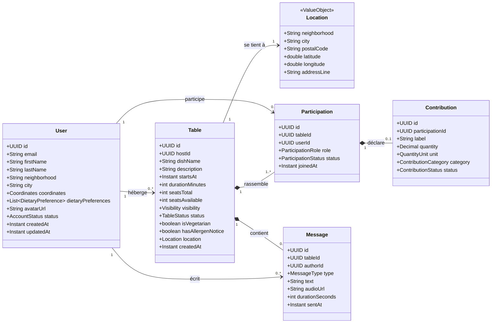
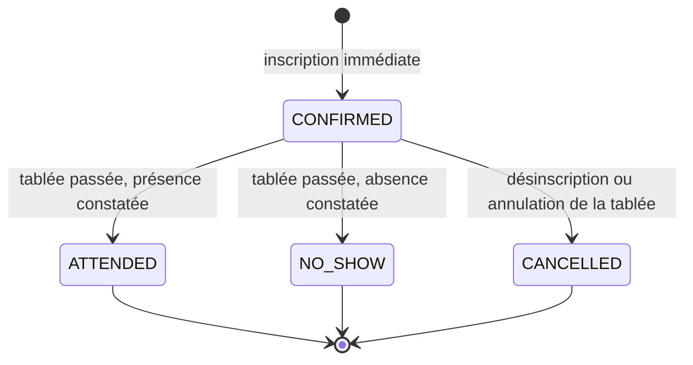
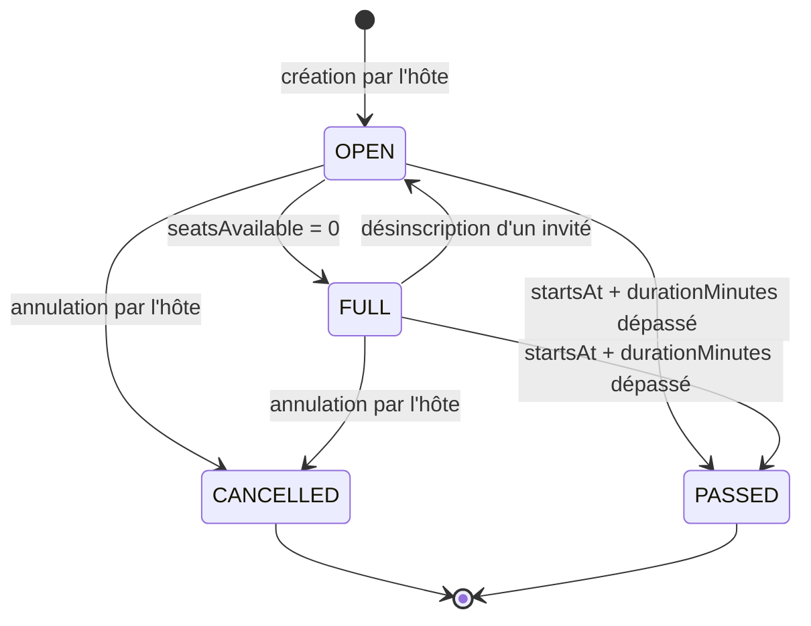

# Modèle de données UML — scénario minimal

Source : parcours client de la maquette « La Bonne Tablée ». Périmètre : le scénario décrit
dans [../README.md](../README.md), points 1 à 7.

## Conventions

| Élément | Convention |
|---|---|
| Identifiants | `camelCase`, en anglais (voir la table de vocabulaire dans le README) |
| Clés primaires | `UUID` version 4, générées côté serveur |
| Horodatages | `Instant`, ISO 8601 en UTC, suffixe `At` (`createdAt`, `startsAt`) |
| Booléens | préfixe `is` ou `has` (`isVegetarian`, `hasAllergenNotice`) |
| Énumérations | valeurs en `UPPER_SNAKE` (`CONFIRMED`, `SANS_PORC` n'existe pas, on écrit `NO_PORK`) |
| Argent, quantités | `Decimal`, jamais de flottant |
| Champs calculés | jamais stockés, marqués « dérivé » dans le dictionnaire |

## Diagramme de classes

Lecture des relations :

- `Table *-- Participation` est une **composition** : une participation n'existe pas sans sa
  tablée, et une tablée porte toujours au moins une participation, celle de son hôte.
- `Participation *-- Contribution` est une composition avec multiplicité `0..1` : un
  participant peut ne rien apporter (« Je ne fais pas les courses »), il ne peut pas
  apporter deux choses distinctes dans le scénario minimal.
- `Location` est un **objet-valeur** embarqué, pas une entité : il n'a pas d'identité propre
  et se modifie avec la tablée.

## Dictionnaire de données

### User

| Champ | Type | Contraintes | Description |
|---|---|---|---|
| `id` | UUID | clé primaire | |
| `email` | String(254) | unique, non nul, format RFC 5322 | Identifiant de connexion, sert au lien magique |
| `firstName` | String(80) | non nul | « Bernard » |
| `lastName` | String(80) | non nul | « Martin » |
| `neighborhood` | String(80) | non nul | « Lyon 7e », sert au calcul des distances |
| `city` | String(80) | non nul | « Lyon » |
| `coordinates` | Coordinates | non nul | Latitude et longitude du quartier, approximatives |
| `dietaryPreferences` | DietaryPreference[] | non nul, défaut `[]` | « Végétarien », « Sans porc » |
| `avatarUrl` | String(2048) | nullable | |
| `status` | AccountStatus | non nul, défaut `ACTIVE` | |
| `createdAt` | Instant | non nul | |
| `updatedAt` | Instant | non nul | |

### Table

| Champ | Type | Contraintes | Description |
|---|---|---|---|
| `id` | UUID | clé primaire | |
| `hostId` | UUID | clé étrangère vers `User.id`, non nul | |
| `dishName` | String(120) | non nul | « Gratin dauphinois ». Le titre affiché en est dérivé |
| `description` | String(600) | nullable | « Un gratin maison à partager entre voisins. » |
| `startsAt` | Instant | non nul, indexé | « Aujourd'hui · 12 h 30 » |
| `durationMinutes` | int | non nul, `> 0`, défaut 120 | Sert à basculer la tablée en `PASSED` |
| `seatsTotal` | int | non nul, `>= 1` | Places ouvertes aux invités, **hôte exclu** |
| `seatsAvailable` | int | **dérivé**, `>= 0` | `seatsTotal` moins les participations confirmées hors hôte |
| `visibility` | Visibility | non nul, défaut `PUBLIC` | |
| `status` | TableStatus | non nul, défaut `OPEN` | |
| `isVegetarian` | boolean | non nul, défaut `false` | Affiche l'étiquette « Végétarien » |
| `hasAllergenNotice` | boolean | non nul, défaut `false` | Affiche « Allergènes indiqués » |
| `location` | Location | non nul, embarqué | |
| `createdAt` | Instant | non nul | |

### Location, objet-valeur embarqué dans Table

| Champ | Type | Contraintes | Description |
|---|---|---|---|
| `neighborhood` | String(80) | non nul | « Lyon 7e » |
| `city` | String(80) | non nul | « Lyon » |
| `postalCode` | String(10) | nullable | |
| `latitude` | double | non nul, `-90` à `90` | Position approximative communiquée aux non-participants |
| `longitude` | double | non nul, `-180` à `180` | |
| `addressLine` | String(200) | nullable | Adresse exacte, renseignée uniquement pour les participants confirmés |

### Participation

| Champ | Type | Contraintes | Description |
|---|---|---|---|
| `id` | UUID | clé primaire | |
| `tableId` | UUID | clé étrangère vers `Table.id`, non nul | |
| `userId` | UUID | clé étrangère vers `User.id`, non nul | |
| `role` | ParticipationRole | non nul | `HOST` ou `GUEST` |
| `status` | ParticipationStatus | non nul, défaut `CONFIRMED` | Voir le diagramme d'états |
| `joinedAt` | Instant | non nul | Affiche « il y a 2 jours » |

Contrainte d'unicité : `(tableId, userId)`. Index : `(userId, status)` pour l'écran « Mes
tablées ».

### Contribution

| Champ | Type | Contraintes | Description |
|---|---|---|---|
| `id` | UUID | clé primaire | |
| `participationId` | UUID | clé étrangère vers `Participation.id`, **unique**, non nul | Une contribution au plus par participation |
| `label` | String(120) | non nul | « Pommes de terre », « salade », « pain » |
| `quantity` | Decimal | nullable | Nul si `category = NONE` |
| `unit` | QuantityUnit | nullable | `KG`, `G`, `L`, `CL`, `UNIT`, `PORTION` |
| `category` | ContributionCategory | non nul | `APPETIZER`, `MAIN`, `DESSERT`, `DRINK`, `INGREDIENT`, `NONE` |
| `status` | ContributionStatus | non nul, défaut `PROPOSED` | |

### Message

| Champ | Type | Contraintes | Description |
|---|---|---|---|
| `id` | UUID | clé primaire | |
| `tableId` | UUID | clé étrangère vers `Table.id`, non nul, indexé | |
| `authorId` | UUID | clé étrangère vers `User.id`, non nul | |
| `type` | MessageType | non nul | `TEXT`, `AUDIO`, `SYSTEM` |
| `text` | String(2000) | nullable | Obligatoire si `type = TEXT` |
| `audioUrl` | String(2048) | nullable | Obligatoire si `type = AUDIO` |
| `durationSeconds` | int | nullable | Renseigné si `type = AUDIO` |
| `sentAt` | Instant | non nul, indexé en ordre décroissant | Tri du fil |

## Énumérations

| Énumération | Valeurs | Remarque |
|---|---|---|
| `AccountStatus` | `ACTIVE`, `SUSPENDED` | |
| `DietaryPreference` | `VEGETARIAN`, `VEGAN`, `NO_PORK`, `NO_GLUTEN`, `NO_LACTOSE`, `HALAL`, `KOSHER`, `NO_NUTS` | Extensible par ajout |
| `Visibility` | `PUBLIC`, `PRIVATE` | `PRIVATE` = accessible seulement aux invités de l'hôte |
| `TableStatus` | `OPEN`, `FULL`, `CANCELLED`, `PASSED` | `FULL` est dérivé de `seatsAvailable = 0` |
| `ParticipationRole` | `HOST`, `GUEST` | |
| `ParticipationStatus` | `CONFIRMED`, `CANCELLED`, `ATTENDED`, `NO_SHOW` | `PENDING` réservé pour une future validation par l'hôte |
| `ContributionCategory` | `APPETIZER`, `MAIN`, `DESSERT`, `DRINK`, `INGREDIENT`, `NONE` | `NONE` = « Je ne fais pas les courses » |
| `ContributionStatus` | `PROPOSED`, `CONFIRMED`, `BROUGHT` | |
| `MessageType` | `TEXT`, `AUDIO`, `SYSTEM` | `SYSTEM` pour « Bernard a rejoint la tablée » |

## Règles métier et invariants

| # | Règle |
|---|---|
| R1 | À la création d'une tablée, l'hôte devient participant avec `role = HOST` et `status = CONFIRMED`. Une tablée a donc toujours au moins une participation. |
| R2 | `seatsAvailable = seatsTotal - count(Participation où role = GUEST et status = CONFIRMED)`. Jamais stocké, jamais écrit à la main. |
| R3 | Rejoindre une tablée exige `status = OPEN`, `seatsAvailable >= 1` et `startsAt` dans le futur. Sinon `409 TABLE_FULL` ou `409 TABLE_CLOSED`. |
| R4 | Un utilisateur ne peut avoir qu'une participation par tablée. Un second appel renvoie `409 ALREADY_PARTICIPATING`. |
| R5 | Une contribution appartient à une participation, jamais directement à un utilisateur. |
| R6 | `category = NONE` implique `quantity` et `unit` nuls. |
| R7 | L'adresse exacte (`location.addressLine`) n'est renvoyée qu'à l'hôte et aux participants confirmés. Les autres reçoivent le quartier et une position arrondie à 300 mètres près, ce qui produit « Lyon 7e · 700 m ». |
| R8 | Un message ne peut être créé que par l'hôte ou un participant confirmé, et seulement si la tablée est `OPEN` ou `FULL`. Les tablées `CANCELLED` et `PASSED` restent en lecture seule. |
| R9 | L'hôte ne peut pas quitter sa propre tablée (`409 HOST_CANNOT_LEAVE`) : il doit l'annuler, ce qui bascule toutes les participations en `CANCELLED`. |
| R10 | Passé `startsAt + durationMinutes`, la tablée devient `PASSED`. Aucune donnée n'est supprimée physiquement : l'historique « Passées » et les fils de discussion restent consultables. |
| R11 | L'hôte peut annuler sa tablée. Un invité ne peut modifier que sa propre contribution et sa propre participation. |

## Diagrammes d'états

## Extensions prévues

Chacune s'ajoute sans modifier les entités existantes.

| Entité | Se rattache à | Cardinalité | Effet sur l'existant |
|---|---|---|---|
| `Review` | `Participation` | `1 Participation 0..1 Review` | Aucun. Alimente l'agrégat `User.rating` déjà exposé en lecture seule |
| `Recipe` | `User` (auteur) | `1 User 0..* Recipe` | Aucun. Nouvelle ressource `/recipes` |
| `Favorite` | `User` et `Table` | `1 User 0..* Favorite`, `1 Table 0..* Favorite` | Aucun. Nouvelle ressource `/me/favorites` |
| `Notification` | `User` | `1 User 0..* Notification` | Aucun. Nouveau canal, hors API REST si le push suffit |
| `Media` | `User` | `1 User 0..* Media` | Aucun. `Message.audioUrl` pointera vers `Media.url` au lieu d'une URL externe |
